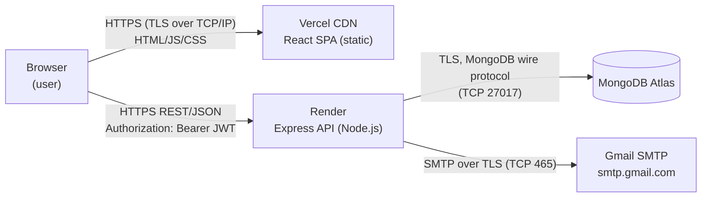

# Computer Networks Documentation

## 1. Client–server architecture

* **Client**: the browser runs the React single-page application.
* **Servers**: Vercel serves static files; Render runs the stateless Express REST API; MongoDB Atlas stores data.
* The API is **stateless**: identity travels in each request (`Authorization: Bearer <JWT>`), so the API scales horizontally.

## 2. Request–response cycle (example: casting a vote)
1. React calls `axios.post('/api/voter/elections/:id/vote', body)`.
2. The browser resolves DNS, opens a **TCP** connection (3-way handshake), performs the **TLS** handshake (HTTPS), and sends an **HTTP/1.1 or HTTP/2** request. In production Vercel rewrites `/api/*` to Render, so the browser sees a single origin.
3. Express middleware chain: Helmet (security headers) → CORS → body parser (100 kB limit) → sanitiser → rate limiter → JWT authentication → role check → Zod validation → controller.
4. The controller talks to MongoDB Atlas over a TLS-protected TCP connection (MongoDB wire protocol, not HTTP).
5. Express answers with a status code and JSON body; Axios interceptors map errors (401 → session expired, network failure → friendly message).

## 3. Topics implemented
| # | Topic | Where |
|---|---|---|
| 1 | Client-server architecture | React SPA ↔ Express API ↔ MongoDB |
| 2 | Frontend–backend communication | `frontend/src/services/api.js` (Axios instance, interceptors) |
| 3 | REST API | `backend/routes/*` – resource URLs, verbs GET/POST/PUT/PATCH/DELETE, JSON, status codes (200/201/400/401/403/404/409/413/423/429/5xx) |
| 4 | HTTP & HTTPS | HSTS header in production (`helmet`), HTTPS terminated by Vercel/Render, `upgrade-insecure-requests` in CSP |
| 5 | TCP/IP | HTTP, SMTP and MongoDB all ride on TCP; no custom protocol is implemented |
| 6 | Request-response | section 2 |
| 7 | CORS | `backend/middleware/security.js` – allow-list from `CORS_ORIGINS`; other origins receive no CORS headers (verified by a test) |
| 8 | Token handling | JWT (HS256, issuer/audience checked, 2 h expiry) in `sessionStorage`, sent as Bearer header; server-side revocation via `tokenVersion` on logout/password change |
| 9 | Secure API requests | HTTPS only in production, input validation, no secrets in the frontend bundle |
| 10 | Rate limiting | `express-rate-limit`: 600/15 min general, 30/15 min auth, 15/15 min OTP, 30/5 min voting; `429` + `RATE_LIMIT_EXCEEDED` security event |
| 11 | HTTP security headers | Helmet: CSP, `X-Content-Type-Options`, `X-Frame-Options`, `Referrer-Policy`, `Cross-Origin-*`, HSTS (prod) |
| 12 | Network error handling | Axios 20 s timeout, friendly messages for offline/timeouts/5xx, retry buttons in every data view |
| 13 | Production HTTPS | `vercel.json` (HSTS, rewrites), Render managed TLS, `TRUST_PROXY=1` so `req.ip`/rate-limits use the real client address |

## 4. Why a Bearer token and not a cookie?
The token is attached explicitly by JavaScript, so a malicious third-party site cannot cause the browser to send it
automatically. This removes the CSRF risk (no cookie-based authentication → no CSRF token needed). The trade-off is that
an XSS flaw could read `sessionStorage`; this is mitigated by React's output escaping, server-side HTML stripping,
and a strict Content-Security-Policy on the API.

## 5. Local vs production networking
| | Local | Production |
|---|---|---|
| Frontend | `http://localhost:5173` (Vite dev server) | Vercel `https://<app>.vercel.app` |
| API | `http://localhost:5000` | Render `https://<api>.onrender.com` |
| `/api` routing | Vite proxy → `:5000` | Vercel rewrite → Render |
| Database | local MongoDB / Atlas | Atlas |

## 6. Not claimed
ElexGuard does **not** implement a custom TCP/UDP protocol; it uses standard application protocols (HTTP, SMTP, MongoDB wire protocol) over TCP/IP.
