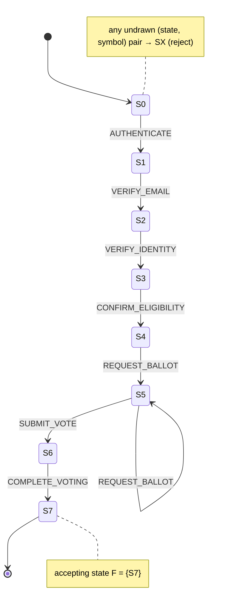

# DFA & FLAT Documentation

## 1. Why a DFA?
A voting session is a *sequence of events* that must occur in a strict order. Sequences of symbols that are
accepted or rejected according to a finite set of rules are exactly what **formal languages and finite automata**
describe (FLAT). ElexGuard models the legal voting workflow as a **regular language** recognised by a
**deterministic finite automaton (DFA)**. The DFA runs **on the backend** and is consulted on every ballot-access
and vote-submission request, so it cannot be bypassed from the browser.

## 2. Formal definition

**M = (Q, Σ, δ, q₀, F)**

| Symbol | Meaning | Value |
|---|---|---|
| Q | finite set of states | {S0, S1, S2, S3, S4, S5, S6, S7, SX} |
| Σ | input alphabet | {AUTHENTICATE, VERIFY_EMAIL, VERIFY_IDENTITY, CONFIRM_ELIGIBILITY, REQUEST_BALLOT, SUBMIT_VOTE, COMPLETE_VOTING} |
| δ | transition function Q × Σ → Q | see table below |
| q₀ | initial state | S0 |
| F | accepting states | {S7} |
| rejecting state | dead / trap state | SX |

| State | Meaning |
|---|---|
| S0 | Not Authenticated |
| S1 | Authenticated |
| S2 | Email Verified |
| S3 | Identity Verified (approved by administrator) |
| S4 | Voter Eligible (constituency + election open) |
| S5 | Ballot Access Granted |
| S6 | Vote Submitted |
| S7 | Voting Completed (accepting) |
| SX | Rejected – absorbing dead state that makes δ **total** |

## 3. Transition table (δ)

| From \ Symbol | AUTHENTICATE | VERIFY_EMAIL | VERIFY_IDENTITY | CONFIRM_ELIGIBILITY | REQUEST_BALLOT | SUBMIT_VOTE | COMPLETE_VOTING |
|---|---|---|---|---|---|---|---|
| **S0** | S1 | SX | SX | SX | SX | SX | SX |
| **S1** | SX | S2 | SX | SX | SX | SX | SX |
| **S2** | SX | SX | S3 | SX | SX | SX | SX |
| **S3** | SX | SX | SX | S4 | SX | SX | SX |
| **S4** | SX | SX | SX | SX | S5 | SX | SX |
| **S5** | SX | SX | SX | SX | S5 | S6 | SX |
| **S6** | SX | SX | SX | SX | SX | SX | S7 |
| **S7** | SX | SX | SX | SX | SX | SX | SX |
| **SX** | SX | SX | SX | SX | SX | SX | SX |

Exactly 8 of the 63 (state, symbol) pairs are valid edges; the other 55 lead to SX (verified by an automated test).
The self-loop on S5 (`REQUEST_BALLOT`) lets a voter refresh the ballot page: a *new* one-time authorisation
is issued and the previous one stops working.

## 4. Diagram

The same diagram is rendered live in the application (`frontend/src/components/DfaDiagram.jsx`) on the
*How it works* page, the voter's election page (with the voter's current state highlighted), the ballot, and the receipt.

## 5. The language L(M)
L(M) = { AUTHENTICATE · VERIFY_EMAIL · VERIFY_IDENTITY · CONFIRM_ELIGIBILITY · REQUEST_BALLOT⁺ · SUBMIT_VOTE · COMPLETE_VOTING }

Equivalently, the regular expression `a b c d e⁺ f g`. Because L(M) is regular, a finite automaton with 9 states
suffices – no counter or stack is needed. Words that skip a symbol, repeat `SUBMIT_VOTE`, or continue after S7
are rejected.

## 6. Code map
| File | Responsibility |
|---|---|
| `backend/services/dfa/dfaDefinition.js` | Q, Σ, q₀, F, rejecting states, δ as data |
| `backend/services/dfa/dfaEngine.js` | `DFA` class: `delta`, `step`, `run` (δ\*), `accepts`, `transitionTable`, `allowedSymbols` – pure, no I/O |
| `backend/services/dfa/votingWorkflow.js` | DFA validation service: maps real facts to symbols, persists state, issues one-time ballot authorisation, handles invalid transitions |
| `backend/services/voting/voteService.js` | Feeds `SUBMIT_VOTE` / `COMPLETE_VOTING` to the DFA and performs the atomic vote |
| `backend/tests/dfa.test.js` | 21 unit tests of the automaton |

## 7. How the DFA is wired into the workflow
Real-world conditions are **guards**; the DFA decides whether the *order* is legal.

| Symbol fed to δ | Guard that must hold |
|---|---|
| AUTHENTICATE | account active (valid JWT) |
| VERIFY_EMAIL | `user.emailVerified` |
| VERIFY_IDENTITY | `voter.verificationStatus === 'approved'` |
| CONFIRM_ELIGIBILITY | voter's constituency is in the election and the election is `active` and inside its time window |
| REQUEST_BALLOT | voter has not already voted |
| SUBMIT_VOTE | state is S5, one-time token valid, candidate belongs to the election |
| COMPLETE_VOTING | automatic after the ballot is stored |

`POST /api/voter/elections/:id/ballot-access` replays the canonical word from the voter's persisted state; if a guard
fails the request stops in the state reached so far (e.g. an unapproved voter stays in **S2**) with HTTP 403.
`POST …/vote` calls `δ(state, SUBMIT_VOTE)`; if the result is SX (e.g. state S4 – no ballot access – or S7 – already
voted) the request is rejected with **409 `DFA_INVALID_TRANSITION`**, a `INVALID_DFA_TRANSITION` security event and an
audit entry are written, and no ballot is stored.

## 7a. Rules → enforcement
| Rule from the specification | Enforced by |
|---|---|
| Unauthenticated users cannot access the ballot | `authenticate` middleware (401) + S0 → only AUTHENTICATE allowed |
| Unverified voters cannot vote | guard VERIFY_EMAIL / VERIFY_IDENTITY; stops in S1/S2 |
| Unapproved voters cannot vote | guard VERIFY_IDENTITY; stops in S2 |
| Ineligible voters cannot vote | guard CONFIRM_ELIGIBILITY; stops in S3 |
| Users cannot skip states | δ undefined edges → SX |
| Completed voters cannot vote again | S7 has no outgoing edges; `hasVoted` flag; unique indexes |
| Invalid transitions are rejected | `rejectTransition()` → 409 + security event |
| DFA logic executes on the backend | all of the above run in Node.js; frontend only displays state |

## 8. Suggested presentation script (FLAT)
1. *Alphabet and language*: events of a voting session are symbols; a legal session is a word.
2. *Why regular?* Fixed order, no counting → finite memory suffices.
3. *Formal tuple and table* (sections 2–3).
4. *Total δ and the dead state*: every unexpected input has a defined outcome – reject.
5. *Live demo*: log in as an unapproved voter → request ballot → server stops at S2; then as an approved voter → S5 → vote → S7;
   try to vote again → 409. Show the security event in the admin console.
6. *Limits*: the DFA validates **order**; guards, atomic database operations and anonymity are enforced by other layers.
