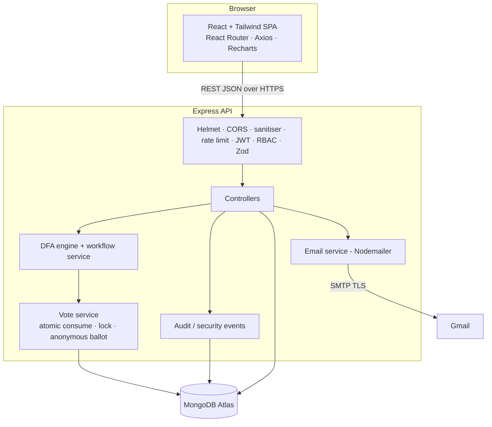

# System Architecture

Layering: `routes → middleware → controllers → services (dfa / voting / email / security) → models`.
The DFA and vote services contain no HTTP code, so they are unit-testable. `app.js` builds the Express app without listening,
which lets Supertest exercise the real stack.

Frontend structure: `layouts/` (Public, Voter, Admin shells), `pages/` (public, auth, voter, admin, shared),
`components/` (design-system UI kit, DFA diagram, results charts), `context/` (auth, toasts), `services/api.js`, `hooks/`, `utils/`.
